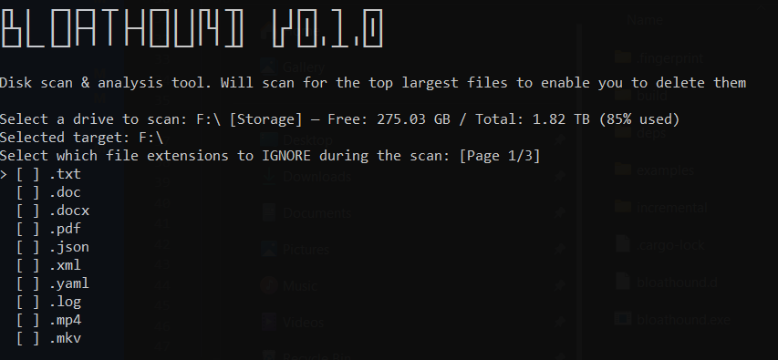
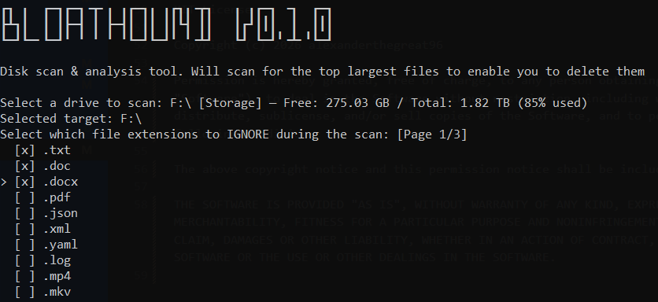
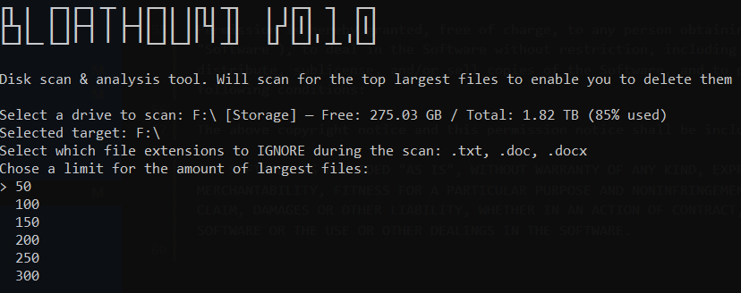
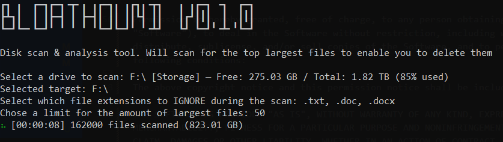
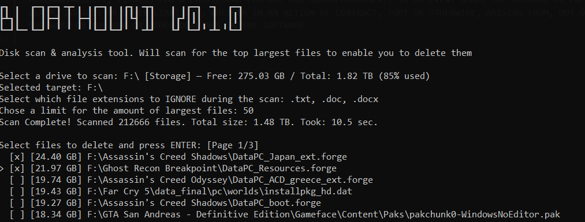
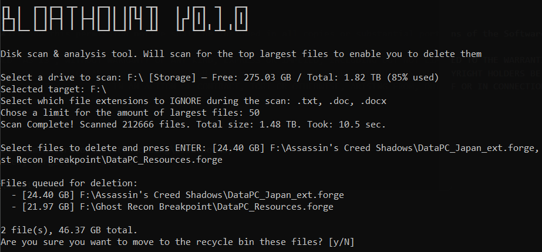

# BloatHound
BloatHound is a CLI utility aimed to solve a specific problem that developers and users might encounter. When your hard-drive gets full, it can get rather hectic when it comes to figuring out what to actually delete. This tool solves that exact problem.

## What can it do?
- **Finds the biggest files on a drive.** The scan walks directories in parallel using `jwalk`, so a drive with over a million files takes under a couple of minutes rather than grinding through one folder at a time.
- **Keeps memory flat no matter how large the drive is.** Rather than collecting every file and sorting at the end, it holds a bounded min-heap of exactly the number of files you asked for. A new file is only kept if it is larger than the smallest one currently held, so scanning a 2 TB drive costs the same memory as scanning a folder.
- **Lets you pick the drive.** Mounted drives are read through `sysinfo` and listed with free space, total space and how full each one is.
- **Filters out extensions you do not care about.** Pick them from a list before the scan starts, or pass them to the `scan` command. Matching is case insensitive, so `.LOG` and `.log` are the same thing.
- **Leaves system files alone.** A predefined per-operating-system list of directories and kernel-held files is skipped while the drive is walked, so they never reach the results. See below for what that covers.
- **Sends deletions to the recycle bin.** Removal goes through `trash`, so anything you delete by accident can be restored from the recycle bin. `--permanent` switches to deleting outright.
- **Asks before it deletes anything.** Your selection is listed back to you with a total size, and the confirmation prompt defaults to no. Afterwards it reports how many files actually went and how much space you got back.
- **Shows progress while it runs.** A spinner reports the running file count and total size as the scan goes, and it keeps animating even while the scanner is stuck in a slow directory.
- **Reports sizes the way your file manager does.** Everything is formatted in binary units, so a 1 TB disk reads as 931.32 GB here and 931 GB in the file manager instead of the two disagreeing.
- **Fits long paths to your terminal.** File names are trimmed from the middle so the size tag and the file name both stay readable, and the selection menu never breaks across lines.

## How does it work?
You run the tool, select a drive, pick any file extensions you want left out, and choose how many of the largest files to keep track of. The scanner then walks the drive recursively and shows you what it found, biggest first. You select the files you want gone, confirm once, and they are removed.

Files go to the recycle bin by default, so a mistake is recoverable. If you want them deleted outright, pass `--permanent` before the command.

## What does it skip?
Scanning a whole drive turns up plenty of things you cannot delete or should not touch, so BloatHound keeps a predefined list of directories and files it refuses to walk into. There is one list per operating system and it gets applied while the drive is being walked, so the entries never reach your results in the first place.


If you want to add or remove entries, they live in `RESTRICTED_ROOT_DIRS` and `RESTRICTED_ROOT_FILES` at the top of `src/bloathound/scanner.rs`.

## Building and Running
```bash
cargo build --release
./target/release/bloathound
```

Running it with no arguments takes you straight into the interactive flow, which is the same as running `bloathound interactive`.

There is also a Makefile if you want release binaries for more than the machine you are on. `make targets` installs what rustup needs, then `make all` builds everything the host can produce and drops it in `bin/`:

```
bin/bloathound-windows-x86_64.exe
bin/bloathound-linux-x86_64
bin/bloathound-linux-aarch64
bin/bloathound-macos-aarch64
```

The two Linux builds are static musl binaries, so they cross-compile from any host and still run on glibc distributions. The Windows and macOS builds need their own platform, because one needs the MSVC libraries and the other needs the Apple SDK; `make all` builds whichever of those the host supports and `make windows` or `make macos` tells you why if you ask for the other one. `make help` lists the rest, and `make check` runs clippy for Windows, Linux and macOS so the platform-specific code stays honest even where it cannot be linked.

## Can I use it without the menus?
Yes. The `scan` subcommand just reports what it finds and exits. It never deletes anything, so it is safe to run from a script or a scheduled job.

```bash
bloathound scan --path /home/me --limit 20
bloathound scan --path D:\ --limit 50 --ignore log,tmp
```

`--path` is the folder to scan, `--limit` is how many of the largest files to report and defaults to 20, and `--ignore` takes a list of extensions to leave out. It exits with 0 on success, 1 if the path does not exist or is not a directory, and 2 if the arguments are wrong.

## Preview
A full run, start to finish. Click any shot to see it full size.

<table>
  <tr>
    <td width="50%" valign="top">
      <a href="image.png"></a>
      <sub><b>1.</b> Pick the drive, then choose any extensions to leave out of the scan.</sub>
    </td>
    <td width="50%" valign="top">
      <a href="image-1.png"></a>
      <sub><b>2.</b> Space marks an extension, Enter moves on.</sub>
    </td>
  </tr>
  <tr>
    <td width="50%" valign="top">
      <a href="image-2.png"></a>
      <sub><b>3.</b> Decide how many of the largest files to keep track of.</sub>
    </td>
    <td width="50%" valign="top">
      <a href="image-3.png"></a>
      <sub><b>4.</b> The scan runs with a live file count and a running total.</sub>
    </td>
  </tr>
  <tr>
    <td width="50%" valign="top">
      <a href="image-4.png"></a>
      <sub><b>5.</b> Results come back biggest first. Mark what you want gone.</sub>
    </td>
    <td width="50%" valign="top">
      <a href="image-5.png"></a>
      <sub><b>6.</b> Your picks are listed back with a total, and the prompt defaults to no.</sub>
    </td>
  </tr>
</table>

The `scan` command skips the menus entirely and prints a plain report:

```text
Scanning src
Scan Complete! Scanned 9 files. Total size: 43.52 KB. Took: 0.0 sec.

Top 6 largest files:
1. [15.50 KB] src\bloathound\scanner.rs
2. [ 7.70 KB] src\bloathound\interactive.rs
3. [ 7.28 KB] src\bloathound\extensions.rs
4. [ 4.84 KB] src\bloathound\disks.rs
5. [ 4.18 KB] src\bloathound\report.rs
6. [ 1.93 KB] src\bloathound\format.rs

Listed files total: 41.42 KB
```

## License
MIT License

Copyright (c) 2026 alexanderthegreat96

Permission is hereby granted, free of charge, to any person obtaining a copy of this software and associated documentation files (the "Software"), to deal in the Software without restriction, including without limitation the rights to use, copy, modify, merge, publish, distribute, sublicense, and/or sell copies of the Software, and to permit persons to whom the Software is furnished to do so, subject to the following conditions:

The above copyright notice and this permission notice shall be included in all copies or substantial portions of the Software.

THE SOFTWARE IS PROVIDED "AS IS", WITHOUT WARRANTY OF ANY KIND, EXPRESS OR IMPLIED, INCLUDING BUT NOT LIMITED TO THE WARRANTIES OF MERCHANTABILITY, FITNESS FOR A PARTICULAR PURPOSE AND NONINFRINGEMENT. IN NO EVENT SHALL THE AUTHORS OR COPYRIGHT HOLDERS BE LIABLE FOR ANY CLAIM, DAMAGES OR OTHER LIABILITY, WHETHER IN AN ACTION OF CONTRACT, TORT OR OTHERWISE, ARISING FROM, OUT OF OR IN CONNECTION WITH THE SOFTWARE OR THE USE OR OTHER DEALINGS IN THE SOFTWARE.
